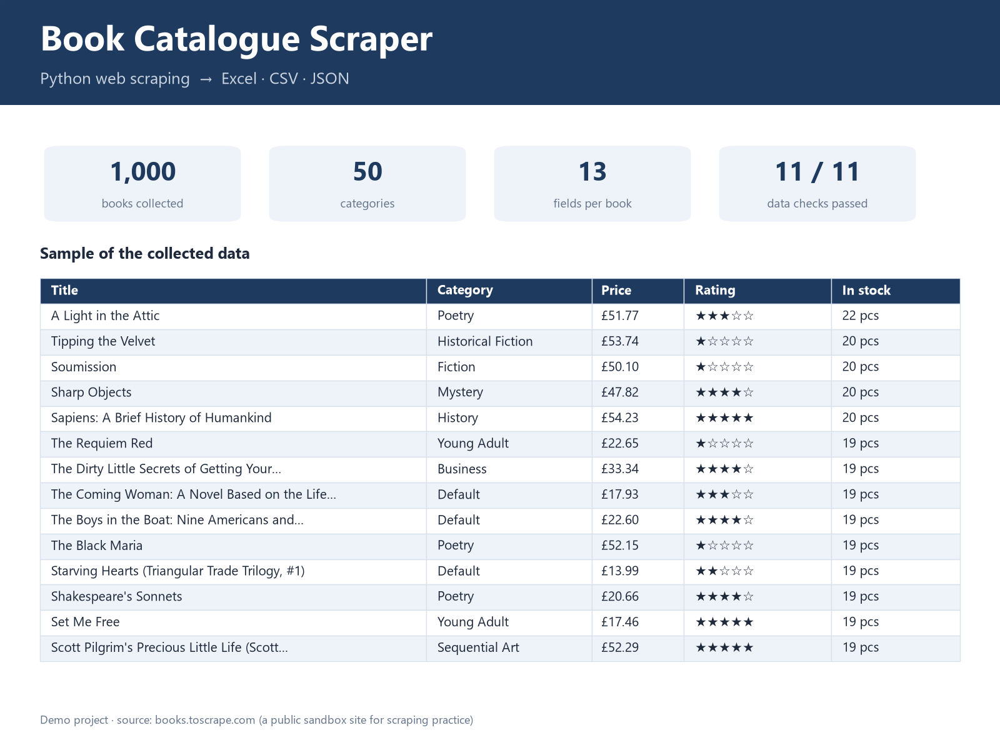

# Book Catalogue Scraper

A Python scraper that collects a full online catalogue (listing pages and every product page) and delivers clean, ready-to-use data in **Excel, CSV and JSON**.

> **Demo project.** The source is [books.toscrape.com](https://books.toscrape.com/), a public sandbox website built for practising web scraping. The same approach works for real e-commerce catalogues, directories and listing sites.



## Result

| | |
|---|---|
| Books collected | **1,000 of 1,000** (matches the total the site reports) |
| Categories | 50 |
| Fields per book | 13 |
| Full run time | about 30 seconds (8 parallel workers) |
| Data checks | 11 / 11 passed |

**Fields:** UPC, title, category, price, price excl. tax, tax, rating (1-5), in stock, stock quantity, number of reviews, product URL, image URL, description.

## Features

- **Full pagination:** walks all 50 listing pages automatically and stops when there is no "next" page.
- **Product details:** opens every product page for the fields that are not on the listing (UPC, stock quantity, category, description).
- **Fast but polite:** parallel downloads with a configurable number of workers and automatic retries with back-off on server errors.
- **Correct encoding:** decodes pages as UTF-8, so prices show as `£51.77`, not `£51.77`.
- **Text cleaning:** fixes problems found in the site's own HTML. It removes the cut-off teaser the site puts in front of every description, strips invisible characters (BOM, soft hyphens, non-breaking spaces), repairs broken encoding in the source text (`â€"` → `—`) and drops the trailing "...more" label.
- **Typed data:** prices are numbers, ratings are 1-5 integers, stock is parsed from text like "In stock (22 available)".
- **Formatted Excel report** with three sheets:
  - *Summary*: totals, price range, stock value, number of 5-star books
  - *Books*: a filterable Excel table with frozen header, currency formatting, clickable links, a price colour scale and stock data bars
  - *By Category*: count, average/min/max price, stock and rating per category, plus a bar chart
- **CSV** saved with a BOM so it opens in Excel with correct characters, and **JSON** for developers and APIs.
- **Data validation script:** compares the result with the site's own counter and checks for duplicates, empty fields, wrong types, broken characters and uncleaned descriptions.

## How to run

Tested on Python 3.13 (Windows).

```bash
pip install -r requirements.txt

python scraper.py              # full catalogue -> output/
python scraper.py --limit 40   # quick test on the first 40 books
python scraper.py --workers 4 --out results

python validate.py             # data quality checks (after a full run)
```

`validate.py` compares the row count with the full catalogue, so after a `--limit` test run that check reports FAIL by design.

Example validation output:

```
[PASS] Row count matches the site: 1000 scraped, site reports 1000
[PASS] No duplicate UPCs: 0 duplicates
[PASS] Required fields filled: 0 empty values
[PASS] Prices are positive numbers: 0 bad prices
[PASS] Ratings are 1-5: 0 out of range
[PASS] No broken or invisible characters: 0 records affected
[PASS] Descriptions cleaned (no duplicated teaser): 0 records affected
[PASS] Excel sheets present: Summary, Books, By Category
[PASS] Excel row count matches JSON: 1000 rows in Excel
[PASS] CSV row count matches JSON: 1000 rows in CSV
[PASS] Categories found: 50 categories

11/11 checks passed
```

## Project structure

```
scraper.py         # crawling and parsing (requests + BeautifulSoup)
exporters.py       # CSV, JSON and formatted Excel export (pandas + openpyxl)
validate.py        # data quality checks
make_previews.py   # renders the preview images in assets/ from the real output
output/            # sample output: books.xlsx, books.csv, books.json
assets/            # preview images
```

## Notes

- "Default" and "Add a comment" are category names used by the sandbox site itself; they are kept as-is.
- When scraping real websites, check the site's terms of use and robots.txt, and keep the request rate reasonable.

## Tech stack

Python · requests · BeautifulSoup (lxml) · pandas · openpyxl · matplotlib
